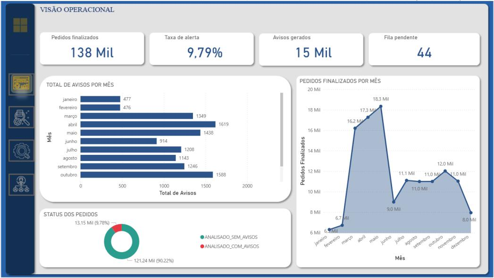

  Tamanho do texto:
  <button onclick="diminuirFonte()" title="Diminuir texto" style="padding: 6px 12px; font-weight: bold; cursor: pointer; border: 1px solid #ccc; border-radius: 4px; background: #f8f9fa;">A-</button>
  <button onclick="resetarFonte()" title="Tamanho normal" style="padding: 6px 12px; font-weight: bold; cursor: pointer; border: 1px solid #ccc; border-radius: 4px; background: #f8f9fa;">A</button>
  <button onclick="aumentarFonte()" title="Aumentar texto" style="padding: 6px 12px; font-weight: bold; cursor: pointer; border: 1px solid #ccc; border-radius: 4px; background: #f8f9fa;">A+</button>
  
  <button onclick="window.print()" style="background-color: #0056b3; color: white; padding: 6px 16px; border: none; border-radius: 5px; font-size: 14px; cursor: pointer; box-shadow: 0 2px 4px rgba(0,0,0,0.2); margin-left: 10px;">
    🖨️ Imprimir ou baixar esta página
  </button>

PÚBLICO-ALVO: DESENVOLVEDORES, ENGENHEIROS DE DADOS E ANALISTAS TÉCNICOS DA EQUIPE COTIN/DELOG

# 3.1. Página 1: Visão Operacional

Apresenta o pulso histórico e o panorama geral de volumetria do sistema.

## KPIs Superiores

- **Pedidos finalizados:** Contagem total de processos de compra concluídos.
- **Taxa de Alerta:** Percentual de processos com status 303 (última versão e únicas).
- **Avisos Gerados:** Total absoluto de alertas gerados no período.
- **Fila Pendente:** Volume de processos aguardando análise na fila de processamento.

## Visões Temporais

- Gráfico de barras horizontais indicando a distribuição mensal de avisos.
- Gráfico de área detalhando o comportamento histórico e picos de processos finalizados por mês.

## Distribuição

- Gráfico de rosca demonstrando a proporção de pedidos analisados categorizados em `"Com Avisos"` versus `"Sem Avisos"`.

<a href="#">⬆️ Voltar ao topo</a>

  <button onclick="window.print()" style="background-color: #0056b3; color: white; padding: 10px 20px; border: none; border-radius: 5px; font-size: 16px; cursor: pointer; box-shadow: 0 2px 4px rgba(0,0,0,0.2);">
    🖨️ Imprimir ou baixar esta página
  </button>

