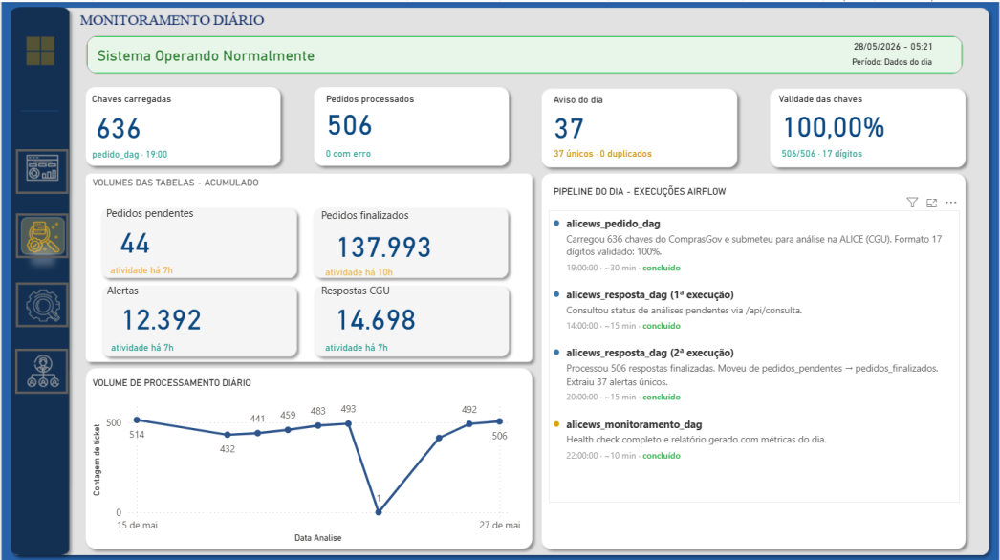

  Tamanho do texto:
  <button onclick="diminuirFonte()" title="Diminuir texto" style="padding: 6px 12px; font-weight: bold; cursor: pointer; border: 1px solid #ccc; border-radius: 4px; background: #f8f9fa;">A-</button>
  <button onclick="resetarFonte()" title="Tamanho normal" style="padding: 6px 12px; font-weight: bold; cursor: pointer; border: 1px solid #ccc; border-radius: 4px; background: #f8f9fa;">A</button>
  <button onclick="aumentarFonte()" title="Aumentar texto" style="padding: 6px 12px; font-weight: bold; cursor: pointer; border: 1px solid #ccc; border-radius: 4px; background: #f8f9fa;">A+</button>
  
  <button onclick="window.print()" style="background-color: #0056b3; color: white; padding: 6px 16px; border: none; border-radius: 5px; font-size: 14px; cursor: pointer; box-shadow: 0 2px 4px rgba(0,0,0,0.2); margin-left: 10px;">
    🖨️ Imprimir ou baixar esta página
  </button>

PÚBLICO-ALVO: DESENVOLVEDORES, ENGENHEIROS DE DADOS E ANALISTAS TÉCNICOS DA EQUIPE COTIN/DELOG

# 3.2. Página 2: Monitoramento Diário (Delay D-1)

Focado no acompanhamento da saúde técnica da integração e volumetria recente das últimas 24 horas.

:::{attention}
**Estratégia de Resiliência (Delay D-1):** Como o ciclo diário de execução das DAGs do Airflow finaliza às 22h00, os cálculos desta tela foram parametrizados para analisar as cargas do dia anterior (D-1). Essa abordagem impede a exibição de dados vazios ou zerados na faixa de horário entre 00h00 e a primeira execução útil da manhã, assegurando dados consistentes para a leitura matinal da gestão.
:::

## Status Geral

Banner dinâmico de cabeçalho que reporta a condição do sistema: `"Operando Normalmente"` ou `"Alerta"`.

## Cartões de Consolidação Diária (D-1)

- **Chaves Carregadas:** Total de chaves transmitidas ao Alice, referenciando a DAG correspondente (`pedido_dag` · 19:00).
- **Pedidos Processados:** Total de compras analisadas com sucesso. Exibe subtítulo que monitora processos com falha.
- **Aviso do Dia:** Total de alertas do período, segmentando a contagem de avisos em `"Únicos"` e `"Duplicados"`.
- **Validade das Chaves:** Mapeia a integridade das chaves (exigência de exatamente 17 dígitos numéricos), reportando a fração de conformidade (ex.: `506/506`).

## Volumes Acumulados

Cartões com o volume acumulado das quatro tabelas principais do schema e indicação de horas decorridas desde a última atualização.

## Pipeline Airflow

Linha do tempo dinâmica em HTML representando os status e horários de execução das DAGs `pedido_dag`, `resposta_dag` e `monitoramento_dag`.

## Volume de Processamento Diário

Gráfico de linhas com o histórico recente de tickets processados por dia. Útil para identificar anomalias bruscas (ex.: quedas severas ou sobrecargas na integração).

<a href="#">⬆️ Voltar ao topo</a>

  <button onclick="window.print()" style="background-color: #0056b3; color: white; padding: 10px 20px; border: none; border-radius: 5px; font-size: 16px; cursor: pointer; box-shadow: 0 2px 4px rgba(0,0,0,0.2);">
    🖨️ Imprimir ou baixar esta página
  </button>

