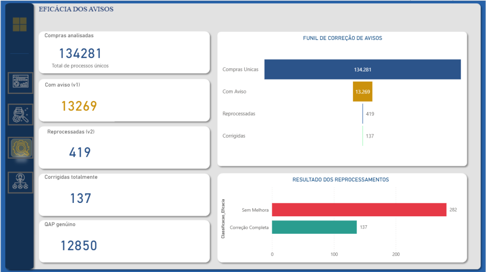

  Tamanho do texto:
  <button onclick="diminuirFonte()" title="Diminuir texto" style="padding: 6px 12px; font-weight: bold; cursor: pointer; border: 1px solid #ccc; border-radius: 4px; background: #f8f9fa;">A-</button>
  <button onclick="resetarFonte()" title="Tamanho normal" style="padding: 6px 12px; font-weight: bold; cursor: pointer; border: 1px solid #ccc; border-radius: 4px; background: #f8f9fa;">A</button>
  <button onclick="aumentarFonte()" title="Aumentar texto" style="padding: 6px 12px; font-weight: bold; cursor: pointer; border: 1px solid #ccc; border-radius: 4px; background: #f8f9fa;">A+</button>
  
  <button onclick="window.print()" style="background-color: #0056b3; color: white; padding: 6px 16px; border: none; border-radius: 5px; font-size: 14px; cursor: pointer; box-shadow: 0 2px 4px rgba(0,0,0,0.2); margin-left: 10px;">
    🖨️ Imprimir ou baixar esta página
  </button>

PÚBLICO-ALVO: DESENVOLVEDORES, ENGENHEIROS DE DADOS E ANALISTAS TÉCNICOS DA EQUIPE COTIN/DELOG

# 3.3. Página 3: Eficácia dos Avisos

Focado na análise de progressão e resolutividade das falhas sinalizadas nos processos.

## KPIs de Análise e Correção

- **Compras analisadas:** Volume total de processos únicos avaliados.
- **Com aviso (v1):** Compras que apresentaram alerta de risco na primeira versão analisada.
- **Reprocessadas (v2+):** Volume de compras que tinham avisos na primeira versão e que retornaram para reanálise após ajustes dos gestores (versão 2 ou superior).
- **Corrigidas totalmente:** Total de compras reprocessadas que atingiram o status de limpas (sem avisos) na sua versão mais recente.
- **QAP genuíno:** Processos que receberam alerta na primeira versão, mas nunca retornaram para reprocessamento, indicando aceitação do risco ou omissão do órgão.

## Funil de Correção

Representação gráfica do fluxo: **Compras Únicas → Compras com Aviso (v1) → Reprocessadas (v2+) → Corrigidas Totalmente**.

## Resultado dos Reprocessamentos

Gráfico demonstrando a divisão binária dos processos reanalisados: `"Correção Completa"` versus `"Sem Melhora"`.

<a href="#">⬆️ Voltar ao topo</a>

  <button onclick="window.print()" style="background-color: #0056b3; color: white; padding: 10px 20px; border: none; border-radius: 5px; font-size: 16px; cursor: pointer; box-shadow: 0 2px 4px rgba(0,0,0,0.2);">
    🖨️ Imprimir ou baixar esta página
  </button>

