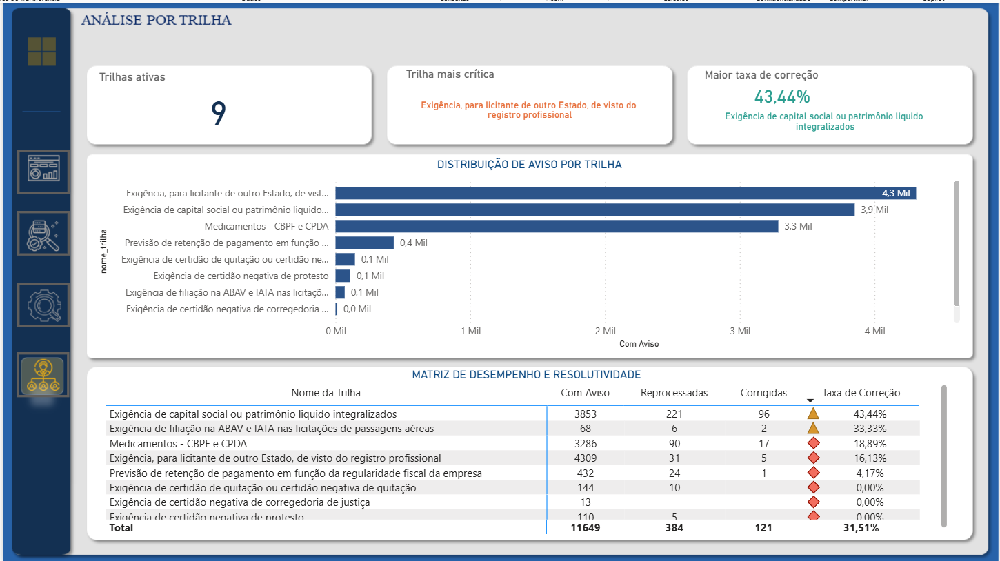

  Tamanho do texto:
  <button onclick="diminuirFonte()" title="Diminuir texto" style="padding: 6px 12px; font-weight: bold; cursor: pointer; border: 1px solid #ccc; border-radius: 4px; background: #f8f9fa;">A-</button>
  <button onclick="resetarFonte()" title="Tamanho normal" style="padding: 6px 12px; font-weight: bold; cursor: pointer; border: 1px solid #ccc; border-radius: 4px; background: #f8f9fa;">A</button>
  <button onclick="aumentarFonte()" title="Aumentar texto" style="padding: 6px 12px; font-weight: bold; cursor: pointer; border: 1px solid #ccc; border-radius: 4px; background: #f8f9fa;">A+</button>
  
  <button onclick="window.print()" style="background-color: #0056b3; color: white; padding: 6px 16px; border: none; border-radius: 5px; font-size: 14px; cursor: pointer; box-shadow: 0 2px 4px rgba(0,0,0,0.2); margin-left: 10px;">
    🖨️ Imprimir ou baixar esta página
  </button>

PÚBLICO-ALVO: DESENVOLVEDORES, ENGENHEIROS DE DADOS E ANALISTAS TÉCNICOS DA EQUIPE COTIN/DELOG

# 3.4. Página 4: Análise por Trilha

Direcionado à identificação e detalhamento de riscos e tipologias.

## KPIs Estratégicos

- Total de Trilhas de Risco ativas.
- Identificação da trilha com maior incidência de alertas (Trilha mais crítica).
- Trilha que apresenta a maior taxa de resolução e correção.

## Distribuição de Avisos por Trilhas

Gráfico de barras horizontais exibindo o total de ocorrências de alertas agrupados por trilhas de auditoria. Direciona ações de capacitação e simplificação normativa do MGI com base nos desvios mais recorrentes.

## Matriz de Desempenho

Tabela analítica cruzando as trilhas de risco com métricas de volumetria, reprocessamento, correção e percentual de resolutividade, com aplicação de formatação condicional baseada em ícones.

<a href="#">⬆️ Voltar ao topo</a>

  <button onclick="window.print()" style="background-color: #0056b3; color: white; padding: 10px 20px; border: none; border-radius: 5px; font-size: 16px; cursor: pointer; box-shadow: 0 2px 4px rgba(0,0,0,0.2);">
    🖨️ Imprimir ou baixar esta página
  </button>

