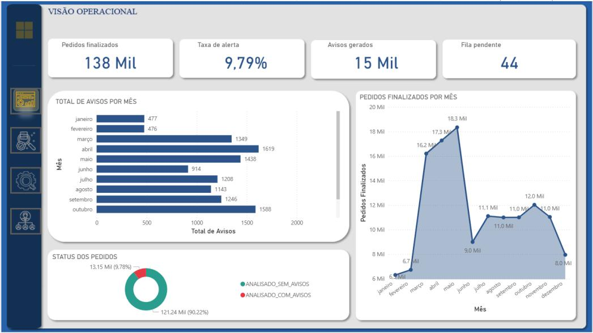
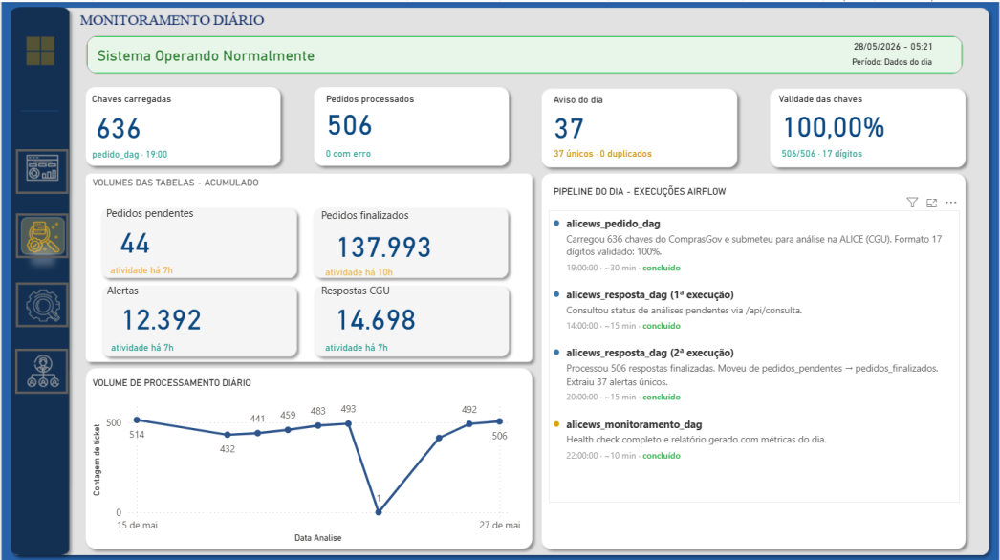
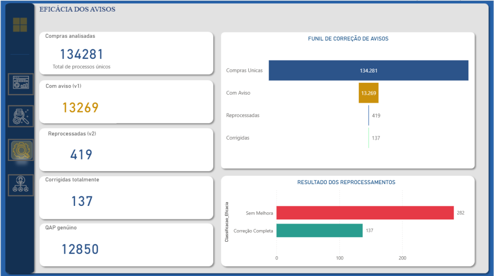
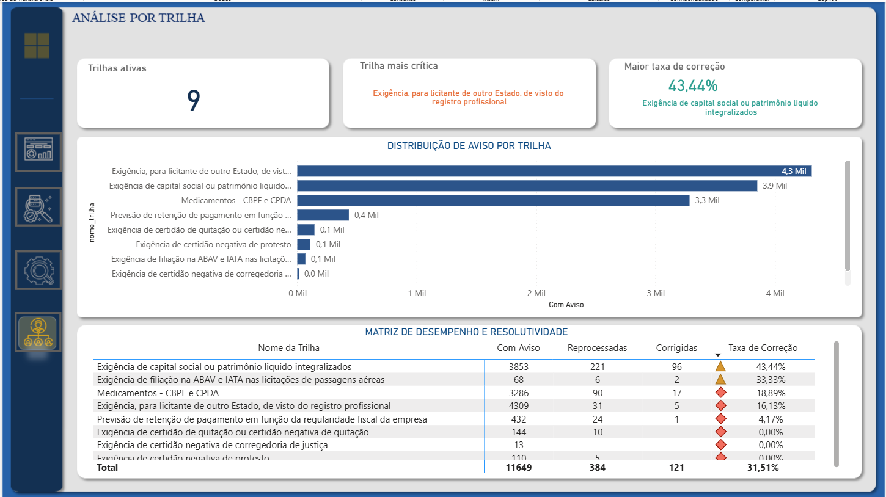

<div class="top-accessibility-bar" style="display: flex; justify-content: flex-end; align-items: center; gap: 8px; margin: 10px 0;">
  <span style="font-size: 14px; color: #555; font-weight: bold;">Tamanho do texto:</span>
  <button onclick="diminuirFonte()" title="Diminuir texto" style="padding: 6px 12px; font-weight: bold; cursor: pointer; border: 1px solid #ccc; border-radius: 4px; background: #f8f9fa;">A-</button>
  <button onclick="resetarFonte()" title="Tamanho normal" style="padding: 6px 12px; font-weight: bold; cursor: pointer; border: 1px solid #ccc; border-radius: 4px; background: #f8f9fa;">A</button>
  <button onclick="aumentarFonte()" title="Aumentar texto" style="padding: 6px 12px; font-weight: bold; cursor: pointer; border: 1px solid #ccc; border-radius: 4px; background: #f8f9fa;">A+</button>
  
  <button onclick="window.print()" style="background-color: #0056b3; color: white; padding: 6px 16px; border: none; border-radius: 5px; font-size: 14px; cursor: pointer; box-shadow: 0 2px 4px rgba(0,0,0,0.2); margin-left: 10px;">
    🖨️ Imprimir ou baixar esta página
  </button>
</div>

<p style="font-weight: bold; color: #d9534f; margin-top: -5px; margin-bottom: 20px;">PÚBLICO-ALVO: DESENVOLVEDORES, ENGENHEIROS DE DADOS E ANALISTAS TÉCNICOS DA EQUIPE COTIN/DELOG</p>

# MANUAL COMPLETO: PAINEL DE INDICADORES ALICEWS

> **Tipo:** Manual  
> **Público-alvo:** Desenvolvedores, Engenheiros de Dados e Analistas Técnicos da equipe COTIN/DELOG  
> **Objetivo:** Documentar a arquitetura, regras de negócio, estrutura visual e lógica de desenvolvimento em DAX do Painel de Indicadores AliceWS.

**VERSÃO 1.1 – Nov/26**  
Ministério da Gestão e da Inovação em Serviços Públicos – MGI

Este manual descreve a arquitetura de dados e a especificação técnica do **Painel de Indicadores AliceWS**, ferramenta desenvolvida para consolidar as métricas de operação, eficácia e integridade técnica da integração entre o sistema Alice e o ComprasGov.

---

<h2 id="sumario">Sumário</h2>

- <a href="#1-visao-geral-e-arquitetura-de-dados">1. Visão Geral e Arquitetura de Dados</a>
- <a href="#2-stack-tecnologica">2. Stack Tecnológica</a>
- <a href="#3-estrutura-do-painel-e-navegacao">3. Estrutura do Painel e Navegação</a>
  - <a href="#3-1-pagina-1-visao-operacional">3.1. Página 1: Visão Operacional</a>
  - <a href="#3-2-pagina-2-monitoramento-diario-delay-d-1">3.2. Página 2: Monitoramento Diário (Delay D-1)</a>
  - <a href="#3-3-pagina-3-eficacia-dos-avisos">3.3. Página 3: Eficácia dos Avisos</a>
  - <a href="#3-4-pagina-4-analise-por-trilha">3.4. Página 4: Análise por Trilha</a>
- <a href="#4-dicionario-de-kpis-e-regras-de-negocio-principais">4. Dicionário de KPIs e Regras de Negócio Principais</a>
- <a href="#5-guia-de-implementacao-e-manutencao-do-dax">5. Guia de Implementação e Manutenção do DAX</a>
- <a href="#6-historico-de-revisoes">6. Histórico de Revisões</a>

---

<h2 id="1-visao-geral-e-arquitetura-de-dados">1. Visão Geral e Arquitetura de Dados</h2>

O Painel de Indicadores AliceWS consolida métricas operacionais e de eficácia da integração Alice-ComprasGov. O painel consome dados diretamente do banco de dados de produção (SQL Server), especificamente do schema `alicews`.

A arquitetura de dados foi desenhada para não exigir tabelas intermediárias ou rotinas adicionais de ETL, atendendo ao **Requisito Não Funcional 1 (RNF1)**. Para garantir alta performance de leitura mesmo sob grandes volumes de dados, o painel faz uso intensivo dos índices já configurados no banco de dados.

<a href="#sumario">⬆️ Voltar ao sumário</a>

---

<h2 id="2-stack-tecnologica">2. Stack Tecnológica</h2>

O ecossistema do painel é composto pelas seguintes tecnologias e responsabilidades:

- **Backend de Dados (SQL Server):** Criação de Views dedicadas que pré-processam as regras de negócio mais pesadas no servidor, otimizando a velocidade de leitura e atualização no Power BI. As Views principais utilizadas são:
  - `vw_operacao_diaria`
  - `vw_analise_eficacia`
  - `vw_api_mgi_avisos_restritos`
  - `vw_api_mgi_chaves_compras`
  - `vw_api_mgi_tickets`
  - `vw_dim_trilhas_nomes`
- **Frontend e Motor Analítico (Power BI):** Construção da interface visual e cálculo de contexto dinâmico/temporal utilizando a linguagem DAX (*Data Analysis Expressions*).
- **Componentes Visuais Customizados (HTML Content):** Utilização do componente certificado *HTML Content* (desenvolvido por Daniel Marsh-Patrick) para renderizar a linha do tempo de execução dos pipelines do Airflow por meio de tags HTML/CSS dinâmicas geradas diretamente por medidas em DAX.
- **Orquestração (Apache Airflow):** Execução das DAGs de integração que atualizam a base de dados nos horários programados: **14h, 19h, 20h e 22h**.

<a href="#sumario">⬆️ Voltar ao sumário</a>

---

<h2 id="3-estrutura-do-painel-e-navegacao">3. Estrutura do Painel e Navegação</h2>

O painel está dividido em quatro visões funcionais e complementares:

<h3 id="3-1-pagina-1-visao-operacional">3.1. Página 1: Visão Operacional</h3>

Apresenta o pulso histórico e o panorama geral de volumetria do sistema.



- **KPIs Superiores:**
  - **Pedidos finalizados:** Contagem total de processos de compra concluídos.
  - **Taxa de Alerta:** Percentual de processos com status 303 (última versão e únicas).
  - **Avisos Gerados:** Total absoluto de alertas gerados no período.
  - **Fila Pendente:** Volume de processos aguardando análise na fila de processamento.
- **Visões Temporais:**
  - Gráfico de barras horizontais indicando a distribuição mensal de avisos.
  - Gráfico de área detalhando o comportamento histórico e picos de processos finalizados por mês.
- **Distribuição:**
  - Gráfico de rosca demonstrando a proporção de pedidos analisados categorizados em `"Com Avisos"` versus `"Sem Avisos"`.

<a href="#sumario">⬆️ Voltar ao sumário</a>

---

<h3 id="3-2-pagina-2-monitoramento-diario-delay-d-1">3.2. Página 2: Monitoramento Diário (Delay D-1)</h3>

Focado no acompanhamento da saúde técnica da integração e volumetria recente das últimas 24 horas.



:::{attention}
**Estratégia de Resiliência (Delay D-1):** Como o ciclo diário de execução das DAGs do Airflow finaliza às 22h00, os cálculos desta tela foram parametrizados para analisar as cargas do dia anterior (D-1). Essa abordagem impede a exibição de dados vazios ou zerados na faixa de horário entre 00h00 e a primeira execução útil da manhã, assegurando dados consistentes para a leitura matinal da gestão.
:::

- **Status Geral:** Banner dinâmico de cabeçalho que reporta a condição do sistema: `"Operando Normalmente"` ou `"Alerta"`.
- **Cartões de Consolidação Diária (D-1):**
  - **Chaves Carregadas:** Total de chaves transmitidas ao Alice, referenciando a DAG correspondente (`pedido_dag` · 19:00).
  - **Pedidos Processados:** Total de compras analisadas com sucesso. Exibe subtítulo que monitora processos com falha.
  - **Aviso do Dia:** Total de alertas do período, segmentando a contagem de avisos em `"Únicos"` e `"Duplicados"`.
  - **Validade das Chaves:** Mapeia a integridade das chaves (exigência de exatamente 17 dígitos numéricos), reportando a fração de conformidade (ex.: `506/506`).
- **Volumes Acumulados:** Cartões com o volume acumulado das quatro tabelas principais do schema e indicação de horas decorridas desde a última atualização.
- **Pipeline Airflow:** Linha do tempo dinâmica em HTML representando os status e horários de execução das DAGs `pedido_dag`, `resposta_dag` e `monitoramento_dag`.
- **Volume de Processamento Diário:** Gráfico de linhas com o histórico recente de tickets processados por dia. Útil para identificar anomalias bruscas (ex.: quedas severas ou sobrecargas na integração).

<a href="#sumario">⬆️ Voltar ao sumário</a>

---

<h3 id="3-3-pagina-3-eficacia-dos-avisos">3.3. Página 3: Eficácia dos Avisos</h3>

Focado na análise de progressão e resolutividade das falhas sinalizadas nos processos.



- **KPIs de Análise e Correção:**
  - **Compras analisadas:** Volume total de processos únicos avaliados.
  - **Com aviso (v1):** Compras que apresentaram alerta de risco na primeira versão analisada.
  - **Reprocessadas (v2+):** Volume de compras que tinham avisos na primeira versão e que retornaram para reanálise após ajustes dos gestores (versão 2 ou superior).
  - **Corrigidas totalmente:** Total de compras reprocessadas que atingiram o status de limpas (sem avisos) na sua versão mais recente.
  - **QAP genuíno:** Processos que receberam alerta na primeira versão, mas nunca retornaram para reprocessamento, indicando aceitação do risco ou omissão do órgão.
- **Funil de Correção:** Representação gráfica do fluxo: **Compras Únicas → Compras com Aviso (v1) → Reprocessadas (v2+) → Corrigidas Totalmente**.
- **Resultado dos Reprocessamentos:** Gráfico demonstrando a divisão binária dos processos reanalisados: `"Correção Completa"` versus `"Sem Melhora"`.

<a href="#sumario">⬆️ Voltar ao sumário</a>

---

<h3 id="3-4-pagina-4-analise-por-trilha">3.4. Página 4: Análise por Trilha</h3>

Direcionado à identificação e detalhamento de riscos e tipologias.



- **KPIs Estratégicos:**
  - Total de Trilhas de Risco ativas.
  - Identificação da trilha com maior incidência de alertas (Trilha mais crítica).
  - Trilha que apresenta a maior taxa de resolução e correção.
- **Distribuição de Avisos por Trilhas:** Gráfico de barras horizontais exibindo o total de ocorrências de alertas agrupados por trilhas de auditoria. Direciona ações de capacitação e simplificação normativa do MGI com base nos desvios mais recorrentes.
- **Matriz de Desempenho:** Tabela analítica cruzando as trilhas de risco com métricas de volumetria, reprocessamento, correção e percentual de resolutividade, com aplicação de formatação condicional baseada em ícones.

<a href="#sumario">⬆️ Voltar ao sumário</a>

---

<h2 id="4-dicionario-de-kpis-e-regras-de-negocio-principais">4. Dicionário de KPIs e Regras de Negócio Principais</h2>

Traduz as Regras de Negócio (RN) estabelecidas nas Histórias de Usuário (HU) em lógicas de dados e tratamento no Power BI:

- **Compras Únicas (RN2):**  
  Lógica: Aplicação de contagem distinta (`DISTINCTCOUNT`) sobre a coluna `ChaveCompra` na tabela `pedidos_finalizados`.

:::{note}
Impede a duplicidade de contagem de uma mesma licitação que tramitou por múltiplos reprocessamentos ou versões de análise.
:::

- **Taxa de Alerta (RN3):**  
  Lógica: Divisão simples entre a contagem de compras únicas cujo último status registrado seja `tipo_status_id = 303` (Alerta) pelo volume geral de compras únicas do período.
- **Identificação de Reprocessadas v2+ (RN11):**  
  Lógica: Seleção de registros da tabela `pedidos_finalizados` onde o campo `versao >= 2` e cuja primeira iteração (`versao = 1`) possuía status de alerta (`tipo_status_id = 303`).
- **Classificação de Reprocessamentos (RN13):**
  - **Correção Completa:** Quando o processo possui versão atualizada com `tipo_status_id = 302` (Analisado sem avisos).
  - **Melhora Parcial:** Versão recente com quantidade de alertas ativos inferior ao volume da primeira versão, mas ainda superior a zero.
  - **Sem Melhora:** Quando a quantidade de alertas da versão recente é igual ou maior do que a versão de origem (`v1`).
- **QAP Genuíno (RN14):**  
  Lógica: Contagem de licitações com `tipo_status_id = 303` na versão inicial (`versao = 1`) que não possuem registros adicionais (`versao >= 2`) no banco, indicando inexistência de tentativa de reprocessamento.
- **Validação de Chaves (RN20):**  
  Lógica: Validação de campo verificando se `LEN(ChaveCompra) = 17` e se todos os caracteres são estritamente numéricos (`ISNUMERIC = 1`).
- **Status Geral do Sistema (RN22):**  
  Lógica: Condição lógica que exige simultaneamente:
  1. Zero erros de processamento no período.
  2. Taxa de validade das chaves em 100%.
  3. Ausência de registros duplicados nas tabelas de controle.
  Caso uma das condições falhe, o status do painel passa de `"Operando Normalmente"` para `"Alerta"`.

<a href="#sumario">⬆️ Voltar ao sumário</a>

---

<h2 id="5-guia-de-implementacao-e-manutencao-do-dax">5. Guia de Implementação e Manutenção do DAX</h2>

Para assegurar o cumprimento do **Requisito Não Funcional 3 (RNF3 — Performance)**, o processamento de dados é dividido: o SQL Server executa as consultas pesadas de agrupamento e junção, e o Power BI calcula contextos dinâmicos e temporais via DAX.

<h3 id="uso-de-variaveis-var">Uso de Variáveis (<code>VAR</code>)</h3>

Todas as medidas em DAX devem seguir o padrão de declaração de variáveis locais (`VAR` e `RETURN`). Isso força o motor analítico a avaliar expressões de filtragem apenas uma vez por execução da medida, otimizando o consumo de memória e diminuindo o tempo de carregamento dos componentes.

Exemplo de estrutura padrão:

```dax
MedidaExemplo = 
VAR _totalPedidos = CALCULATE(COUNTROWS('pedidos_finalizados'))
VAR _pedidosAlerta = CALCULATE(COUNTROWS('pedidos_finalizados'), 'pedidos_finalizados'[tipo_status_id] = 303)
RETURN
DIVIDE(_pedidosAlerta, _totalPedidos, 0)
```

<h3 id="inteligencia-temporal-d-1">Inteligência Temporal D-1</h3>

Para evitar cartões e gráficos diários vazios durante a madrugada e início da manhã, as medidas de monitoramento diário usam um desvio dinâmico. Se a hora atual da máquina de execução estiver compreendida entre **00h00 e 05h00**, os cálculos de inteligência temporal mudam seu parâmetro de referência de data de `TODAY()` para `TODAY() - 1` (dia anterior).

<h3 id="timeline-html-dinamica-pipeline-airflow">Timeline HTML Dinâmica (Pipeline Airflow)</h3>

A linha do tempo do Airflow é gerada usando a função iteradora `CONCATENATEX`, que varre a tabela dimensional de pipelines do dia, analisa seu status de execução (Sucesso, Executando ou Erro) e concatena blocos de string contendo tags `<div>` e estilos CSS inline. O resultado textual é lido e renderizado visualmente pelo visual *HTML Content*.

<a href="#sumario">⬆️ Voltar ao sumário</a>

---

<h2 id="6-historico-de-revisoes">6. Histórico de Revisões</h2>

| Data | Versão | Descrição | Autor |
|---|---|---|---|
| 2026-06-15 | 1.0 | Versão inicial | Pablio Sousa |
| 2026-11-18 | 1.1 | Conversão e publicação em plataforma web (Read the Docs) no padrão visual DELOG, com estrutura multi-página, controles de acessibilidade, lightbox de imagens e versão consolidada para impressão | Páblio de Sousa Lourenço |

<a href="#sumario">⬆️ Voltar ao sumário</a>

<div class="bottom-print-bar" style="text-align: right; margin: 20px 0;">
  <button onclick="window.print()" style="background-color: #0056b3; color: white; padding: 10px 20px; border: none; border-radius: 5px; font-size: 16px; cursor: pointer; box-shadow: 0 2px 4px rgba(0,0,0,0.2);">
    🖨️ Imprimir ou baixar esta página
  </button>
</div>
